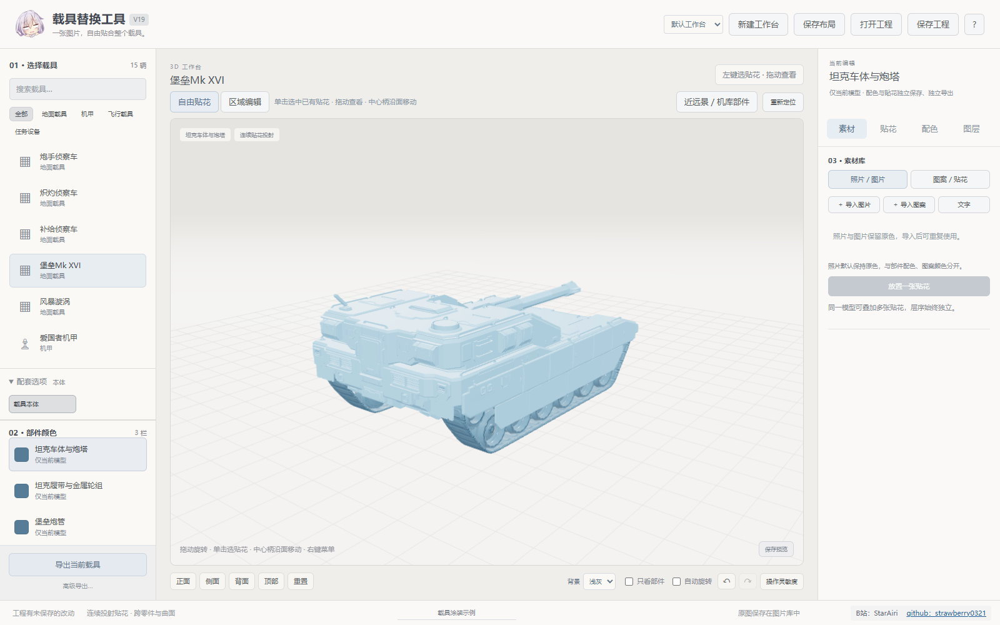
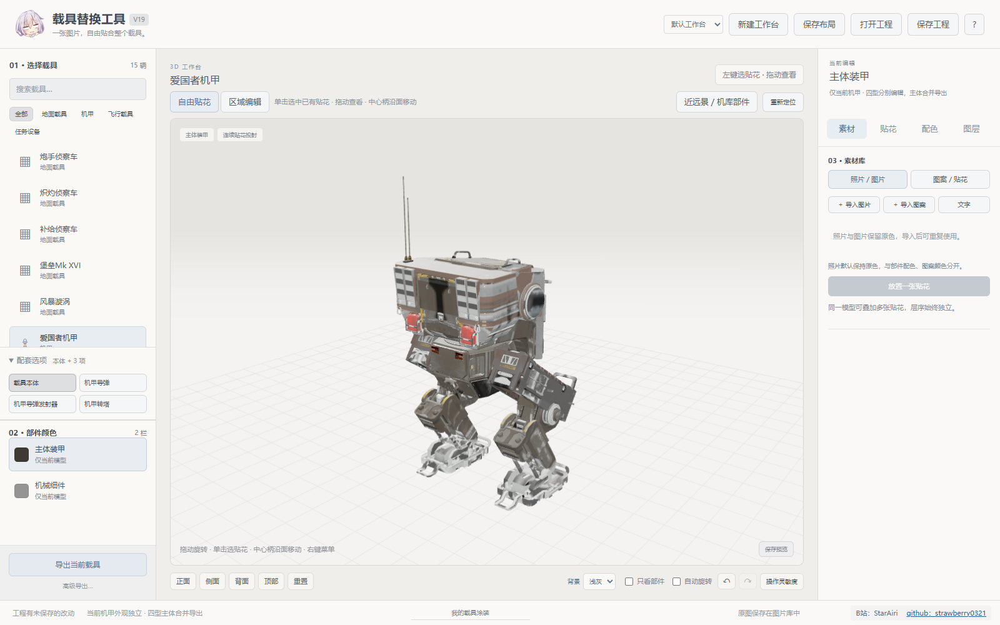
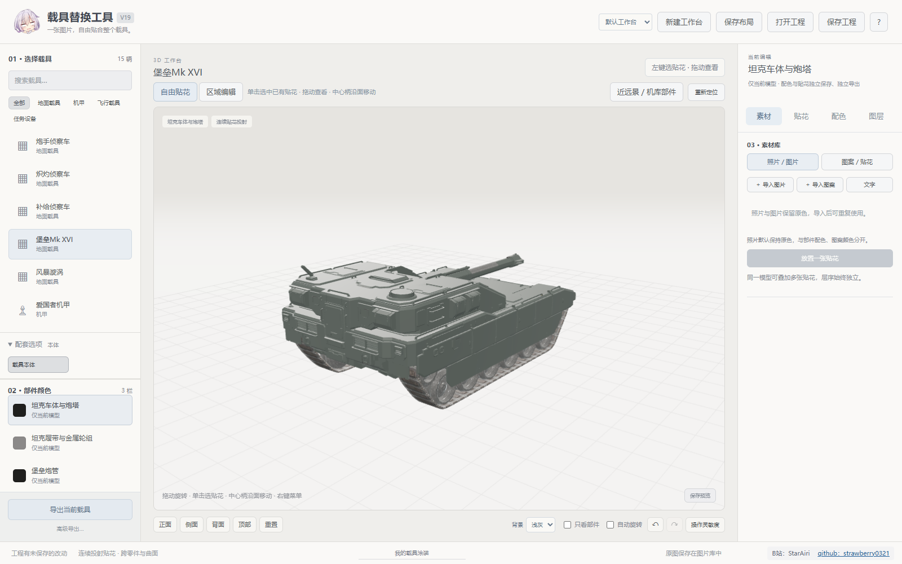
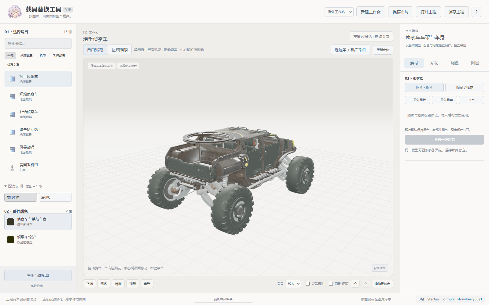
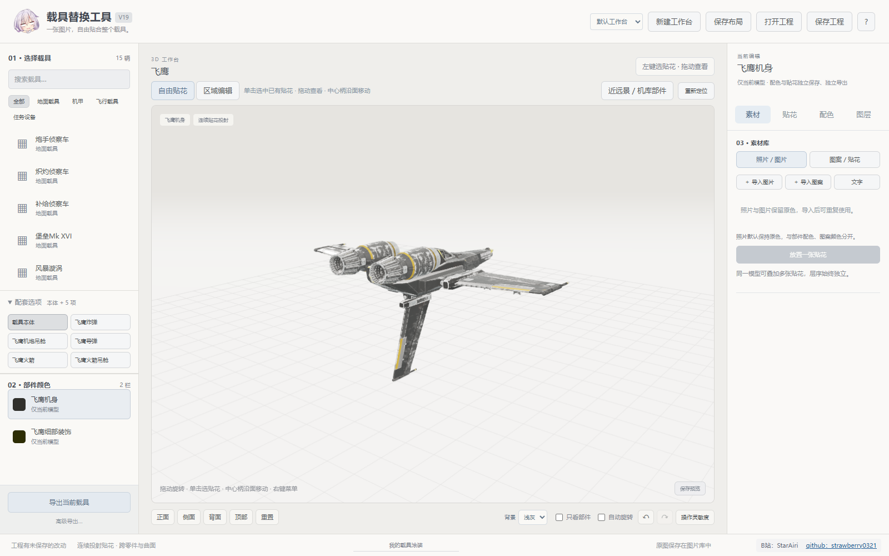
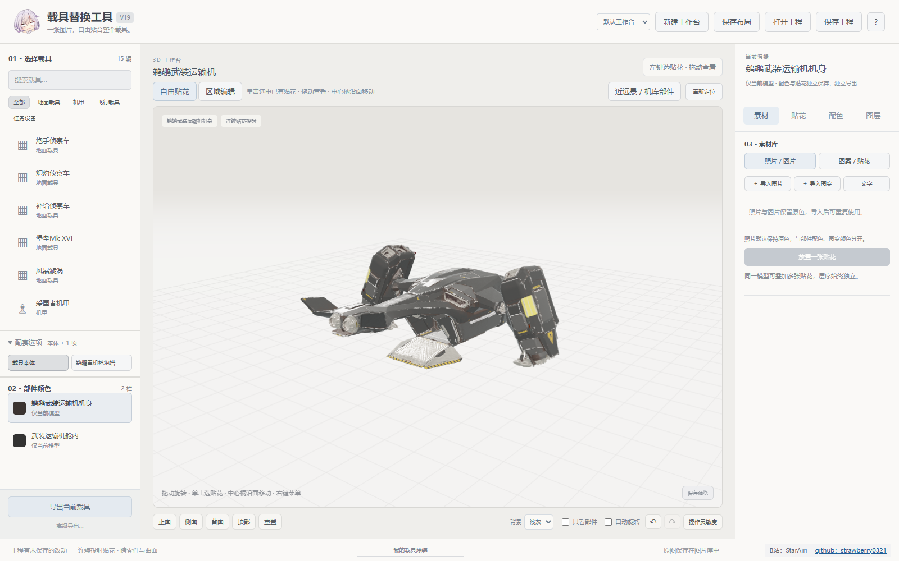
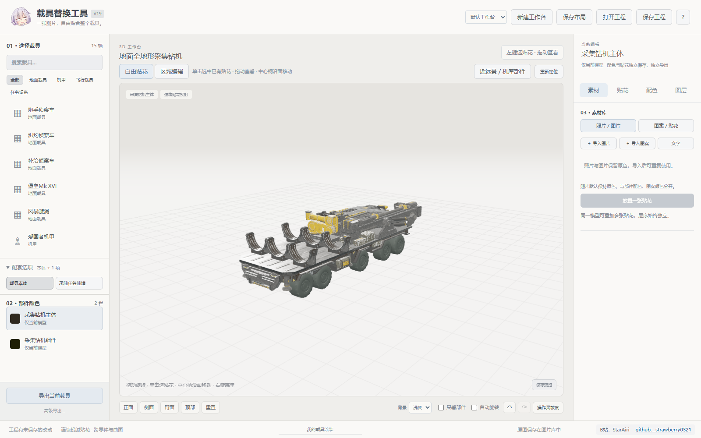

**本软件没有数字签名，Windows 会提示“未知发布者”，并可能阻止运行。**

# 绝地潜兵 2 · 载具涂装工具

给载具换颜色、贴图片、加文字，在 3D 工作台里调整好后导出 MOD。软件免费使用，不会自动向游戏目录安装文件。

**[下载 Windows 版](https://github.com/strawberry0321/HD2-Vehicle-Paint-Studio/releases/latest)** · [B站：StarAiri](https://space.bilibili.com/437268141)

下载 Release 里的 `载具替换工具_V19_Windows_x64.zip`，完整解压，双击 `载具替换工具.exe`。
需要 Windows 10/11 64 位、.NET Framework 4.8 和 Microsoft Edge WebView2 运行时。仓库里的“Download ZIP”是源码，不是完整软件。

## 能改哪些载具

| 分区 | 范围 |
| --- | --- |
| 机甲 | 爱国者、解放者、伐木者、突破，以及对应武器和部件 |
| 坦克 | 堡垒 Mk XVI、风暴漩涡，以及主炮、发射井和烟幕部件 |
| 地面侦察车 | 炮手、炽灼、补给等车型，以及配套武器、油罐和货架 |
| 飞鹰 | 机体、炸弹、导弹、火箭及吊舱，包含舰船机库中的对应状态和挂件 |
| 鹈鹕与运输机 | 武装运输机、油罐运输机、载具运输机、人员运输机及炮塔 |
| 任务采油设备 | 全地形采集钻机、采油任务油罐 |

下面是软件里的模型预览，不是游戏截图。

| 机甲 | 坦克 |
| --- | --- |
|  |  |
| 地面侦察车 | 飞鹰 |
|  |  |
| 鹈鹕与运输机 | 任务采油设备 |
|  |  |

## 基本用法

1. 选择载具和部件，改整组配色，或者选一块区域单独改色。
2. 导入 PNG、JPG、WebP 图片，也可以直接添加文字和内置图案。
3. 放置贴花后调整位置、尺寸、旋转、透明度和层序。支持跨起伏投射、圆杆环绕和多个部件一起贴。
4. 保存工程后可随时继续编辑。导出可以选择当前载具、整个类别或全部载具。
5. 将导出的 ZIP 导入 MOD 管理器。每个 ZIP 都带预览图和可重新打开的工程。

部件配色支持覆盖原版骷髅、编号和色条，也能查看近远景、机库部件等不同模型状态。
四型机甲可以分别制作外观；因为主体几何共用，导出时会一起处理。

导出前会另存完整工程备份。导出有进度、耗时和取消按钮，未修改的贴图可以复用缓存。
素材和工作台默认保存在程序旁的 `载具涂装数据` 文件夹中；移动软件时记得一起保留。

## 代码放在哪里

| 目录 | 内容 |
| --- | --- |
| `app/` | Python 后端、3D 工作台和界面 |
| `native/desktop/` | WebView2 桌面窗口 |
| `native/launcher/` | Windows 启动程序 |
| `native/reader/` | 补丁回读校验器 |
| `scripts/` | 构建、打包脚本 |
| `docs/` | 构建说明和软件截图 |
| `licenses/` | 第三方许可 |
| `third_party/` | 校验器需要的固定版本 Filediver 源码 |

仓库只放源码和必要文档；运行库、载具资源随 Release 提供，不包含作者的素材库、制作工程、缓存或诊断记录。
构建方法见 [构建说明](docs/BUILD.md)。

## 二次开发要求

本软件支持非商业二次开发，**严禁售卖软件，包括修改版和换皮版**。
二次开发和再发布必须保留软件右下角的原作者水印，并附上 [原作者 B站链接](https://space.bilibili.com/437268141) 和 [原 GitHub 仓库链接](https://github.com/strawberry0321/HD2-Vehicle-Paint-Studio)。
水印文件中的作者署名及链接严禁更改，不得删除、隐藏或遮挡。详细条款见 [LICENSE](LICENSE) 和 [AUTHORSHIP.md](AUTHORSHIP.md)。
